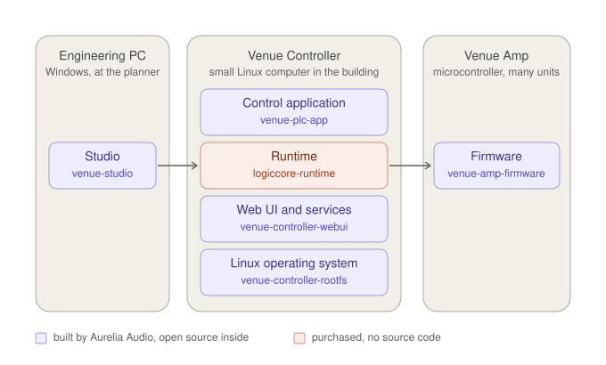

# Architecture: aura-venue-controller

Version 0.1.0 · 2026-11-20 · Diagram: [ARCHITECTURE.drawio](ARCHITECTURE.drawio) (pages "System" and
"Hardware")

## System overview and purpose

The Venue Controller is a small Linux computer in the equipment room of a building. It receives the
control application from the engineering software, executes it in a purchased runtime and drives the
amplifiers over the network. This repository assembles everything that makes up the controller
except the operating system.

## Components and responsibilities

| Component | Responsibility | Origin | Where |
|---|---|---|---|
| Control application (`venue-plc-app`) | Logic of one installation ("on fire alarm, page zone 3") | written by the integrator | aura-venue-studio (sample) |
| Runtime (`logiccore-runtime`) | Executes the control application | purchased, binary only | `vendor/logiccore/` |
| Web UI (`venue-controller-webui`) | Configuration pages served by the device, with bundled web server and interpreter | Aurelia Audio, bundled open source | `webui/` (planned) |
| Controller services | Device management, update, audio routing | Aurelia Audio | `services/` (planned) |
| Operating system (`venue-controller-rootfs`) | Embedded Linux | platform team | aura-venue-os, linked module |
| Mainboard | Processor, memory, network, secure element, service ports | Aurelia Audio, real parts | `hardware/` |

"Firmware" of the controller means the whole package of operating system, runtime, web UI and
services that is installed on the device as one image.

## Key interfaces and data flows

| From | To | What |
|---|---|---|
| Engineering PC (Studio) | Runtime on the controller | download of the control application, online diagnosis |
| Browser in the building LAN | Web UI | configuration |
| Controller | Amplifiers | control commands and audio over the audio network |
| Update medium (network or USB stick) | Controller | firmware image |
| Secure element | Controller services | device key and certificate |

Protocols and ports are not fixed yet.

## Infrastructure and deployment

Nothing is deployed. The repository is input for analysis.

Communication with the TrustSource API (uploads and imports from CI) uses the organisation secret
`AURA_UPLOAD_KEY`, sent as the `x-api-key` header. The base URL including the API version comes from
`TS_API_BASE_URL`; it is not hard-coded. No workflow exists yet.

Mapping to TrustSource: one project "Aura Venue Controller" with modules for web UI and services,
the runtime as a third-party component with the supplier's SBOM, the operating system as a linked
module pointing to an approval of the aura-venue-os project, and the hardware bill of materials
attached to the product node.

### Documentation site

This repository also hosts the documentation of the whole Aura Venue example. `docs/` and
`mkdocs.yml` are built with Zensical (Material design, same look as the ts-scan documentation) by
the workflow `.github/workflows/docs.yml` and published to GitHub Pages at
`https://aura-venue.trustsource.io`. The workflow runs on changes to the
documentation on `main`. No analytics and no web fonts are loaded.

## Architecture decision records

### ADR-001: Four repositories, operating system separate

- **Date:** 2026-11-20 (v0.1.0)
- **Status:** Accepted
- **Context:** The example has to reflect how device manufacturers organise their work: a platform
  team builds the Linux, product teams build devices on top of it, and engineering software is a
  product of its own. A single repository would hide exactly the hand-over points that cause the
  difficulties we want to study. A separate operating-system repository also leaves room for OS
  variants.
- **Decision:** Four repositories: `aura-venue-studio`, `aura-venue-controller`, `aura-venue-os`,
  `aura-venue-firmware`. In TrustSource each one is a project of its own. The operating system is
  included in the controller project as a **linked module** (a module that refers to another project
  and one of its approvals). The purchased runtime is a third-party component of the controller.
- **Consequences:** The controller depends on a specific approved state of the operating system, not
  on its source. Cross-repository topics (system overview, measurement log) need one agreed home.
  Linked-module behaviour across OS versions becomes part of what is tested (see aura-venue-os).

### ADR-002: Realistic artefacts instead of running software, measured against a ground truth

- **Date:** 2026-11-20 (v0.1.0)
- **Status:** Accepted
- **Context:** The purpose is to learn where scanning and vulnerability matching succeed and where
  manual work remains. That needs realistic input and a reference to compare with, not a working
  product.
- **Decision:** Repositories contain realistic files (manifests, vendored sources, binaries, images,
  supplier documents) that need not build or run. Each repository carries a `truth.yaml` with the
  real content and the expected vulnerabilities, each entry backed by a source. Only freely licensed
  third-party files are used; no proprietary binaries of real suppliers.
- **Consequences:** Results are reproducible and can be published. Building `truth.yaml` is real
  effort and has to be kept in step with every change to the content.

### ADR-003: Hardware concept and HBOM live in the device repository

- **Date:** 2026-11-20 (v0.1.0)
- **Status:** Accepted
- **Context:** Hardware has no repository of its own. The hardware bill of materials (HBOM) is needed
  for the product record and as evidence for the device threat analysis (MITRE EMB3D).
- **Decision:** The hardware concept of each device lives in `hardware/` of the repository of that
  device: controller here, amplifier in aura-venue-firmware. HBOM documents are CycloneDX using
  hardware component types. Parts are real, common types so that manufacturer plus part number is a
  valid identity.
- **Consequences:** Hardware and software of a device are versioned together. Board revisions and
  variants have to be expressed in the same repository (baseline plus delta documents).

### ADR-004: Purchased runtime kept under vendor/ with the supplier's documents

- **Date:** 2026-11-20 (v0.1.0)
- **Status:** Proposed
- **Context:** Many device manufacturers buy the runtime that executes control applications. They
  receive a binary, sometimes an SBOM, and security advisories from the supplier. This hand-over is
  one of the cases to be studied.
- **Decision:** The runtime is kept under `vendor/logiccore/` as a binary without source, together
  with a supplier SBOM (CycloneDX) and a supplier advisory (CSAF with VEX). The stand-in is packaged
  from freely licensed open-source components; no binaries of real runtime suppliers are used.
- **Consequences:** The supplier's naming and format have to be mapped into the product. A "not
  affected" statement of the supplier has to be passed on. The stand-in must be documented in
  `truth.yaml` so that the supplier SBOM can deliberately differ from the real content.

### ADR-005: One documentation site for all four repositories, hosted here

- **Date:** 2026-11-20 (v0.1.0)
- **Status:** Accepted
- **Context:** Procedure and design decisions of the example are to be documented as a teaching piece
  for product security documentation under the Cyber Resilience Act. The documentation spans all
  four repositories and needs one home.
- **Decision:** The site lives in `docs/` of this repository, because the controller is where all
  parts come together, and is published with GitHub Pages. Tooling and design follow the ts-scan
  documentation. Analytics, cookie consent and the feedback widget of ts-scan are not taken over.
- **Consequences:** Documentation changes for the other repositories are committed here. The site is
  served under the custom domain `aura-venue.trustsource.io`, so its address does not depend on the
  name of this repository. The domain has to be verified in the GitHub organisation, so that the
  subdomain cannot be taken over if the DNS entry ever points to nothing.

## Open decisions

- Structure of the documentation site; whether the measurement log is part of it.
- Protocols between Studio, controller and amplifier.
- Ethernet PHY of the controller: Microchip KSZ9031 (current choice) or Qualcomm AR8031 (used on
  NXP's evaluation kit).
- Variant of the secure element; replacement or deliberate keeping of the Wi-Fi module that its
  manufacturer lists as "to be discontinued".
