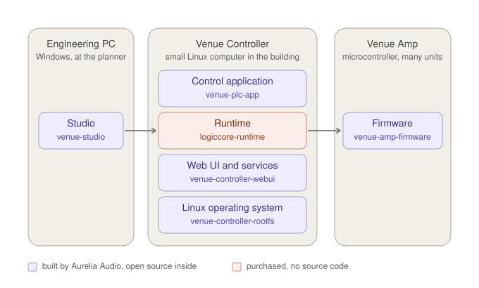

# aura-venue-controller

Assembles all components for the Aura Venue Controller: the device's own software, the purchased
runtime, the reference to the operating system and the hardware concept of the controller board.

## About Aura Venue

Aura Venue is a **fictional** fixed-installation audio system (paging and background music for
buildings) by the equally fictional Aurelia Audio GmbH. TrustSource uses it as a worked example of
what a device manufacturer has to deal with: embedded Linux, bare-metal firmware, a purchased
runtime, Windows engineering software and real hardware parts.

The files in these repositories **do not have to build or run**. They have to look like a real
development project, so that scanning, component identification, vulnerability matching, hardware
bills of materials and device threat analysis can be exercised on realistic input and the results
compared with a known ground truth.

| Repository | Content | Runs on |
|---|---|---|
| [aura-venue-studio](https://github.com/trustsource/aura-venue-studio) | Engineering software, sample control application | Engineering PC (Windows) |
| [aura-venue-controller](https://github.com/trustsource/aura-venue-controller) | Web UI, controller services, purchased runtime, controller hardware concept | Venue Controller |
| [aura-venue-os](https://github.com/trustsource/aura-venue-os) | Embedded Linux of the controller, in several variants | Venue Controller |
| [aura-venue-firmware](https://github.com/trustsource/aura-venue-firmware) | Bare-metal firmware, amplifier hardware concept | Venue Amp |

The engineering PC loads the control application onto the controller. The controller drives the
amplifiers over the network. Purple parts are built by Aurelia Audio (with open source inside), the
coral part is purchased as a binary without source code.

## What belongs here

| Path | Content | State |
|---|---|---|
| `hardware/` | Hardware concept of the controller mainboard, basis for the HBOM | concept present |
| `vendor/logiccore/` | Purchased runtime: binary, supplier SBOM, supplier advisory | placeholder |
| `webui/` | Web UI shipped inside the device (web server, PHP and other bundled binaries) | planned |
| `services/` | Controller services written by Aurelia Audio | planned |
| `docs/`, `mkdocs.yml` | Documentation site for the whole Aura Venue example, <https://aura-venue.trustsource.io> | set up, structure open |

The operating system is **not** in this repository. It lives in
[aura-venue-os](https://github.com/trustsource/aura-venue-os) and is included as a linked module.

## Status

Version 0.1.0 (2026-11-20): repository structure and concept only. No product code yet. See
[CHANGELOG.md](CHANGELOG.md) and [ARCHITECTURE.md](ARCHITECTURE.md).

## Ground truth

[truth.yaml](truth.yaml) lists what is really contained in this repository (component, version,
origin, how it got in) and which vulnerabilities are expected for it. Every scan result is measured
against this file. Entries are backed by sources, not estimated.

## License

Our own work in this repository (documentation, concepts, example data and code written for Aura
Venue) is licensed under [Creative Commons Attribution-ShareAlike 4.0 International](https://creativecommons.org/licenses/by-sa/4.0/)
(CC BY-SA 4.0): you may share and adapt it, provided you give credit and distribute your
contributions under the same licence.

This repository also uses open-source software components. These remain under their own licence
terms, which take precedence for those components. The bill of materials is in
[SBOM.cdx.json](SBOM.cdx.json) in the root directory; further information on the licences of the components
is in [NOTICE.md](NOTICE.md), also in the root directory.

## Disclaimer

Aurelia Audio and Aura Venue do not exist. Third-party products and parts named here are real and
are used as examples only; their names are trademarks of their owners. No affiliation or
endorsement is implied.
