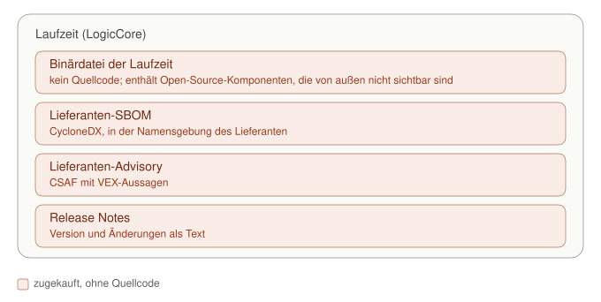

# Laufzeit (LogicCore)

Die Laufzeit führt die Steuerlogik aus. Aurelia Audio schreibt sie nicht selbst, sondern kauft sie beim fiktiven Lieferanten LogicCore: eine Binärdatei ohne Quellcode, dazu die Stückliste und die Sicherheitshinweise des Lieferanten.

## Bausteine

| Baustein | Aufgabe | Herkunft |
|---|---|---|
| Binärdatei der Laufzeit | kein Quellcode; enthält Open-Source-Komponenten, die von außen nicht sichtbar sind | zugekauft, ohne Quellcode |
| Lieferanten-SBOM | CycloneDX, in der Namensgebung des Lieferanten | zugekauft, ohne Quellcode |
| Lieferanten-Advisory | CSAF mit VEX-Aussagen | zugekauft, ohne Quellcode |
| Release Notes | Version und Änderungen als Text | zugekauft, ohne Quellcode |

## Architektur im Detail

- [Architekturbeschreibung](https://github.com/trustsource/aura-venue-controller/blob/main/vendor/logiccore/ARCHITECTURE.md)
- [Diagramm (draw.io)](https://github.com/trustsource/aura-venue-controller/blob/main/vendor/logiccore/ARCHITECTURE.drawio) (mit diagrams.net oder der draw.io-Desktop-App öffnen)
- [Repository](https://github.com/trustsource/aura-venue-controller)

Die verlinkten Dateien sind auf Englisch verfasst.

## Stand

Nur Konzept, noch kein Produktcode.
