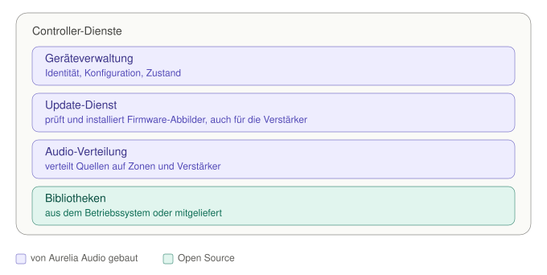

# Controller-Dienste

Die Controller-Dienste sind die eigene Software des Geräts: Sie verwalten das Gerät, spielen Updates ein und verteilen Audio an die Verstärker.

## Bausteine

| Baustein | Aufgabe | Herkunft |
|---|---|---|
| Geräteverwaltung | Identität, Konfiguration, Zustand | von Aurelia Audio gebaut |
| Update-Dienst | prüft und installiert Firmware-Abbilder, auch für die Verstärker | von Aurelia Audio gebaut |
| Audio-Verteilung | verteilt Quellen auf Zonen und Verstärker | von Aurelia Audio gebaut |
| Bibliotheken | aus dem Betriebssystem oder mitgeliefert | Open Source |

## Architektur im Detail

- [Architekturbeschreibung](https://github.com/trustsource/aura-venue-controller/blob/main/services/ARCHITECTURE.md)
- [Diagramm (draw.io)](https://github.com/trustsource/aura-venue-controller/blob/main/services/ARCHITECTURE.drawio) (mit diagrams.net oder der draw.io-Desktop-App öffnen)
- [Repository](https://github.com/trustsource/aura-venue-controller)

Die verlinkten Dateien sind auf Englisch verfasst.

## Stand

Nur Konzept, noch kein Produktcode.
