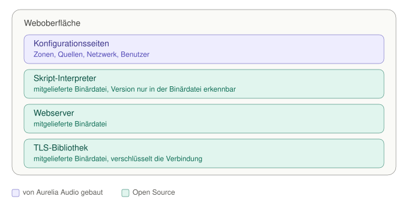

# Weboberfläche

Die Weboberfläche ist das, was ein Techniker sieht, wenn er die Adresse des Controllers im Browser aufruft. Neben den Seiten von Aurelia Audio braucht sie einen Webserver und einen Skript-Interpreter, die als fertige Binärdateien ins Gerät gepackt werden.

## Bausteine

| Baustein | Aufgabe | Herkunft |
|---|---|---|
| Konfigurationsseiten | Zonen, Quellen, Netzwerk, Benutzer | von Aurelia Audio gebaut |
| Skript-Interpreter | mitgelieferte Binärdatei, Version nur in der Binärdatei erkennbar | Open Source |
| Webserver | mitgelieferte Binärdatei | Open Source |
| TLS-Bibliothek | mitgelieferte Binärdatei, verschlüsselt die Verbindung | Open Source |

## Architektur im Detail

- [Architekturbeschreibung](https://github.com/trustsource/aura-venue-controller/blob/main/webui/ARCHITECTURE.md)
- [Diagramm (draw.io)](https://github.com/trustsource/aura-venue-controller/blob/main/webui/ARCHITECTURE.drawio) (mit diagrams.net oder der draw.io-Desktop-App öffnen)
- [Repository](https://github.com/trustsource/aura-venue-controller)

Die verlinkten Dateien sind auf Englisch verfasst.

## Stand

Nur Konzept, noch kein Produktcode.
