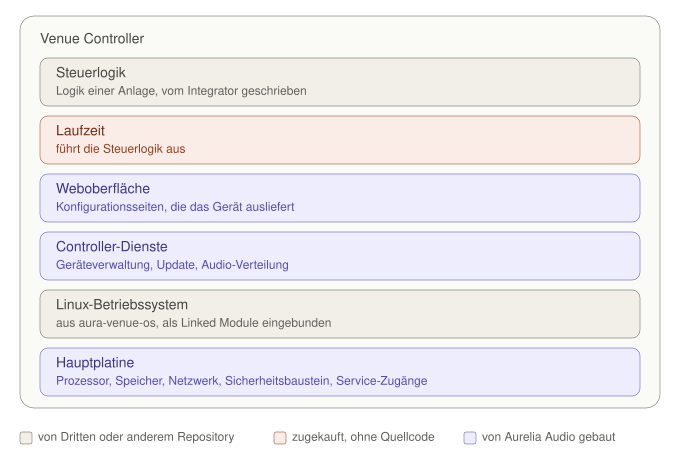

# Venue Controller

Der Venue Controller ist ein kleiner Linux-Rechner im Technikraum. Er erhält die Steuerlogik aus Venue Studio, führt sie in einer zugekauften Laufzeit aus und steuert die Verstärker über das Netzwerk. Seine Firmware ist das ganze Paket der Schichten unten, als ein Abbild aufgespielt.

## Bausteine

| Baustein | Aufgabe | Herkunft |
|---|---|---|
| Steuerlogik | Logik einer Anlage, vom Integrator geschrieben | von Dritten oder anderem Repository |
| Laufzeit | führt die Steuerlogik aus | zugekauft, ohne Quellcode |
| Weboberfläche | Konfigurationsseiten, die das Gerät ausliefert | von Aurelia Audio gebaut |
| Controller-Dienste | Geräteverwaltung, Update, Audio-Verteilung | von Aurelia Audio gebaut |
| Linux-Betriebssystem | aus aura-venue-os, als Linked Module eingebunden | von Dritten oder anderem Repository |
| Hauptplatine | Prozessor, Speicher, Netzwerk, Sicherheitsbaustein, Service-Zugänge | von Aurelia Audio gebaut |

## Architektur im Detail

- [Architekturbeschreibung](https://github.com/trustsource/aura-venue-controller/blob/main/ARCHITECTURE.md)
- [Diagramm (draw.io)](https://github.com/trustsource/aura-venue-controller/blob/main/ARCHITECTURE.drawio) (mit diagrams.net oder der draw.io-Desktop-App öffnen)
- [Hardware-Konzeption](https://github.com/trustsource/aura-venue-controller/blob/main/hardware/README.md)
- [Repository](https://github.com/trustsource/aura-venue-controller)

Die verlinkten Dateien sind auf Englisch verfasst.

## Bausteine des Controllers

- [Weboberfläche](controller-webui.md)
- [Controller-Dienste](controller-services.md)
- [Laufzeit (LogicCore)](controller-runtime.md)
- [Venue OS](os.md)

## Stand

Nur Konzept, noch kein Produktcode.
