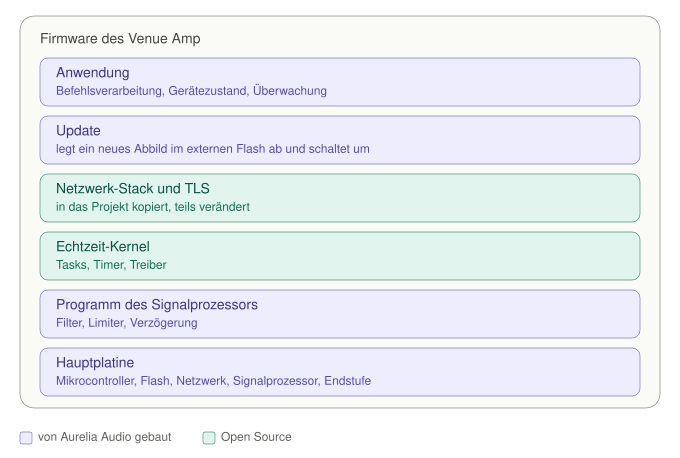

# Firmware des Venue Amp

Der Venue Amp ist ein Netzwerk-Verstärker mit Mikrocontroller, Signalprozessor und Endstufe. Ein Betriebssystem gibt es nicht: Die Firmware ist ein einziges Programm, das direkt auf dem Chip läuft. Fremdcode wird in das Projekt kopiert, wie in Embedded-C üblich.

## Bausteine

| Baustein | Aufgabe | Herkunft |
|---|---|---|
| Anwendung | Befehlsverarbeitung, Gerätezustand, Überwachung | von Aurelia Audio gebaut |
| Update | legt ein neues Abbild im externen Flash ab und schaltet um | von Aurelia Audio gebaut |
| Netzwerk-Stack und TLS | in das Projekt kopiert, teils verändert | Open Source |
| Echtzeit-Kernel | Tasks, Timer, Treiber | Open Source |
| Programm des Signalprozessors | Filter, Limiter, Verzögerung | von Aurelia Audio gebaut |
| Hauptplatine | Mikrocontroller, Flash, Netzwerk, Signalprozessor, Endstufe | von Aurelia Audio gebaut |

## Architektur im Detail

- [Architekturbeschreibung](https://github.com/trustsource/aura-venue-firmware/blob/main/ARCHITECTURE.md)
- [Diagramm (draw.io)](https://github.com/trustsource/aura-venue-firmware/blob/main/ARCHITECTURE.drawio) (mit diagrams.net oder der draw.io-Desktop-App öffnen)
- [Hardware-Konzeption](https://github.com/trustsource/aura-venue-firmware/blob/main/hardware/README.md)
- [Repository](https://github.com/trustsource/aura-venue-firmware)

Die verlinkten Dateien sind auf Englisch verfasst.

## Stand

Nur Konzept, noch kein Produktcode.
