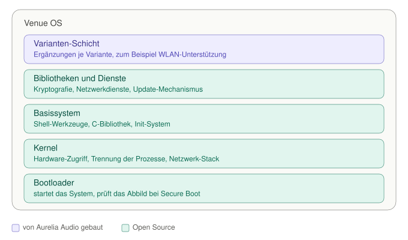

# Venue OS

Venue OS ist das Embedded Linux des Controllers. Ein Plattform-Team stellt es aus einer Distribution zusammen: einige hundert Pakete vom Kernel bis zur Kryptografie-Bibliothek, keines davon von Aurelia Audio geschrieben. Es wird getrennt gepflegt und freigegeben und existiert in mehreren Varianten.

## Bausteine

| Baustein | Aufgabe | Herkunft |
|---|---|---|
| Varianten-Schicht | Ergänzungen je Variante, zum Beispiel WLAN-Unterstützung | von Aurelia Audio gebaut |
| Bibliotheken und Dienste | Kryptografie, Netzwerkdienste, Update-Mechanismus | Open Source |
| Basissystem | Shell-Werkzeuge, C-Bibliothek, Init-System | Open Source |
| Kernel | Hardware-Zugriff, Trennung der Prozesse, Netzwerk-Stack | Open Source |
| Bootloader | startet das System, prüft das Abbild bei Secure Boot | Open Source |

## Architektur im Detail

- [Architekturbeschreibung](https://github.com/trustsource/aura-venue-os/blob/main/ARCHITECTURE.md)
- [Diagramm (draw.io)](https://github.com/trustsource/aura-venue-os/blob/main/ARCHITECTURE.drawio) (mit diagrams.net oder der draw.io-Desktop-App öffnen)
- [Repository](https://github.com/trustsource/aura-venue-os)

Die verlinkten Dateien sind auf Englisch verfasst.

## Stand

Nur Konzept, noch kein Produktcode.
