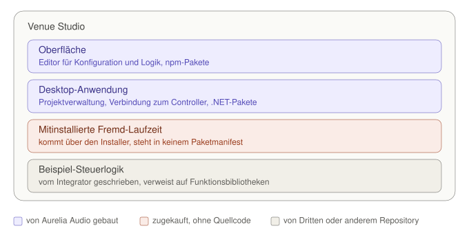

# Venue Studio

Venue Studio ist die Engineering-Software. Sie läuft auf einem Windows-PC beim Planer oder Integrator. Mit ihr wird eine Anlage beschrieben, die Steuerlogik geschrieben und beides auf den Controller geladen.

## Bausteine

| Baustein | Aufgabe | Herkunft |
|---|---|---|
| Oberfläche | Editor für Konfiguration und Logik, npm-Pakete | von Aurelia Audio gebaut |
| Desktop-Anwendung | Projektverwaltung, Verbindung zum Controller, .NET-Pakete | von Aurelia Audio gebaut |
| Mitinstallierte Fremd-Laufzeit | kommt über den Installer, steht in keinem Paketmanifest | zugekauft, ohne Quellcode |
| Beispiel-Steuerlogik | vom Integrator geschrieben, verweist auf Funktionsbibliotheken | von Dritten oder anderem Repository |

## Architektur im Detail

- [Architekturbeschreibung](https://github.com/trustsource/aura-venue-studio/blob/main/ARCHITECTURE.md)
- [Diagramm (draw.io)](https://github.com/trustsource/aura-venue-studio/blob/main/ARCHITECTURE.drawio) (mit diagrams.net oder der draw.io-Desktop-App öffnen)
- [Repository](https://github.com/trustsource/aura-venue-studio)

Die verlinkten Dateien sind auf Englisch verfasst.

## Stand

Nur Konzept, noch kein Produktcode.
