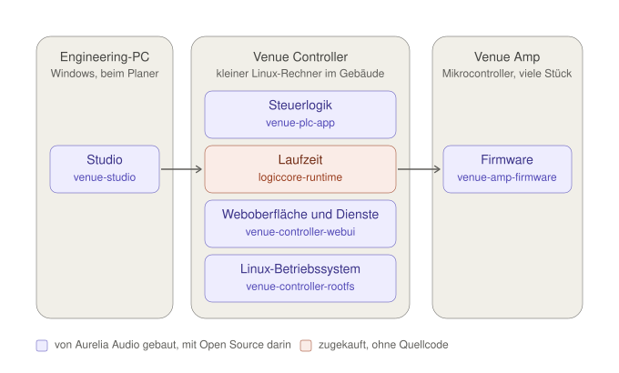

# Aura Venue

Aura Venue ist ein **erfundenes** Beschallungssystem für Gebäude der ebenfalls erfundenen Aurelia
Audio GmbH: ein Controller im Technikraum, Netzwerk-Verstärker im ganzen Gebäude und eine
Engineering-Software auf dem PC des Planers. TrustSource baut es als durchgearbeitetes Beispiel.

Diese Seite dokumentiert das gesamte Vorgehen und jede Entwurfsentscheidung auf dem Weg. Sie ist als
Lehrstück gedacht: Wie sieht die Dokumentation eines Produkts mit digitalen Elementen aus, wenn sie
vom ersten Tag an geführt wird, wie es der Cyber Resilience Act erwartet?

## Einstieg

- [Die Produkte](products.md): was die drei Geräte tun und wer beteiligt ist.
- Komponenten, jeweils mit kurzer technischer Beschreibung, Architektur-Skizze und Verweisen auf die
  Architektur-Dateien im Repository:
  [Venue Studio](components/studio.md), [Venue Controller](components/controller.md),
  [Venue OS](components/os.md), [Firmware des Venue Amp](components/firmware.md).

## Die Repositories

| Repository | Inhalt | Läuft auf |
|---|---|---|
| [aura-venue-studio](https://github.com/trustsource/aura-venue-studio) | Engineering-Software, Beispiel-Steuerlogik | Engineering-PC (Windows) |
| [aura-venue-controller](https://github.com/trustsource/aura-venue-controller) | Weboberfläche, Controller-Dienste, zugekaufte Laufzeit, Hardware-Konzeption des Controllers | Venue Controller |
| [aura-venue-os](https://github.com/trustsource/aura-venue-os) | Embedded Linux des Controllers in mehreren Varianten | Venue Controller |
| [aura-venue-firmware](https://github.com/trustsource/aura-venue-firmware) | Firmware ohne Betriebssystem, Hardware-Konzeption des Verstärkers | Venue Amp |

Die Repositories selbst sind auf Englisch geführt.

## Stand

Das Projekt hat gerade begonnen. Die Repositories enthalten Struktur und Konzepte, noch keinen
Produktcode.

## Gut zu wissen

Die Dateien in den Repositories müssen sich nicht bauen oder ausführen lassen. Sie müssen aussehen
wie ein echtes Entwicklungsprojekt, damit Scannen, Erkennen von Komponenten, Zuordnen von
Schwachstellen, Hardware-Stücklisten und die Bedrohungsanalyse für Geräte an realistischem Material
geübt und gegen eine bekannte Soll-Liste gemessen werden können.

Aurelia Audio und Aura Venue gibt es nicht. Genannte Produkte und Bauteile Dritter sind echt und
dienen nur als Beispiel.
