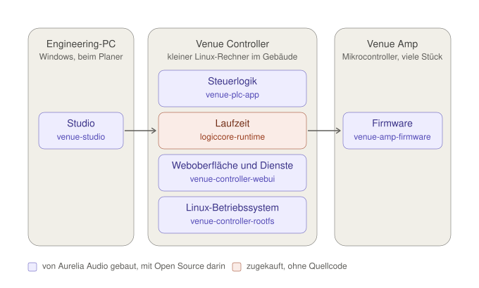

# Die Produkte

Aura Venue bringt Durchsagen und Hintergrundmusik in Gebäude wie Hotels, Schulen oder Bahnhöfe. Es
besteht aus drei Produkten, die zusammenarbeiten.

## Venue Studio

Die Engineering-Software für Planer und Integratoren. Auf einem Windows-PC beschreiben sie das
Gebäude (Zonen, Verstärker, Quellen) und schreiben die Steuerlogik, zum Beispiel "bei Feueralarm
Durchsage in Zone 3". Studio lädt beides auf den Controller und hilft bei der Diagnose während der
Inbetriebnahme.

[Technische Beschreibung](components/studio.md)

## Venue Controller

Das Zentrum einer Anlage: ein kleiner Linux-Rechner im Technikraum. Er führt die Steuerlogik aus,
stellt eine Weboberfläche zur Konfiguration bereit und steuert die Verstärker über das Netzwerk.
Varianten unterscheiden sich in der Ausstattung, zum Beispiel mit WLAN oder ohne Sicherheitsbaustein.

Im Controller arbeiten mehrere Teile unterschiedlicher Herkunft zusammen: das Betriebssystem, eine
zugekaufte Laufzeit, die die Steuerlogik ausführt, die Weboberfläche und die eigenen Dienste des
Controllers.

[Technische Beschreibung](components/controller.md)

## Venue Amp

Der Netzwerk-Verstärker. Ein Gebäude hat viele davon, einen je Zone oder Lautsprechergruppe. Er
erhält Audio und Befehle vom Controller, bearbeitet den Klang und treibt die Lautsprecher. In ihm
steckt nur ein Mikrocontroller; seine Firmware ist ein einziges Programm.

[Technische Beschreibung](components/firmware.md)

## Wer beteiligt ist

| Rolle | Wer | Beitrag |
|---|---|---|
| Hersteller | Aurelia Audio | baut Controller, Verstärker und Studio; verantwortet die Produkte |
| Plattform-Team | innerhalb von Aurelia Audio | stellt das Betriebssystem zusammen und gibt es frei |
| Lieferant | LogicCore (erfunden) | liefert die Laufzeit als Binärdatei mit eigenen Dokumenten |
| Fertigungspartner | Elektronikfertiger | baut die Platinen, liefert Stücklisten |
| Integrator | Planungsbüro oder Errichter | schreibt die Steuerlogik einer Anlage |
| Betreiber | Eigentümer des Gebäudes | betreibt die Anlage, spielt Updates ein |

Jede Übergabe zwischen diesen Rollen ist eine Stelle, an der Informationen über Komponenten und
Schwachstellen weitergegeben werden müssen. Darum geht es in diesem Beispiel.
