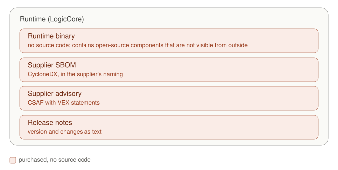

# Runtime (LogicCore)

The runtime executes the control application. Aurelia Audio does not write it but buys it from the fictional supplier LogicCore: a binary without source code, accompanied by the supplier's bill of materials and security advisories.

## Building blocks

| Building block | What it does | Origin |
|---|---|---|
| Runtime binary | no source code; contains open-source components that are not visible from outside | purchased, no source code |
| Supplier SBOM | CycloneDX, in the supplier's naming | purchased, no source code |
| Supplier advisory | CSAF with VEX statements | purchased, no source code |
| Release notes | version and changes as text | purchased, no source code |

## Architecture in detail

- [Architecture description](https://github.com/trustsource/aura-venue-controller/blob/main/vendor/logiccore/ARCHITECTURE.md)
- [Diagram (draw.io)](https://github.com/trustsource/aura-venue-controller/blob/main/vendor/logiccore/ARCHITECTURE.drawio) (open in diagrams.net or the draw.io desktop app)
- [Repository](https://github.com/trustsource/aura-venue-controller)

The linked files are written in English.

## Status

Concept only; no product code yet.
