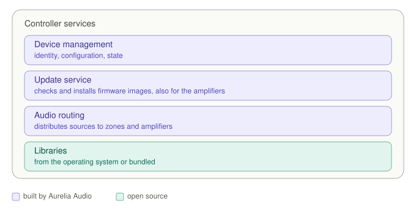

# Controller services

The controller services are the device's own software: they manage the device, install updates and route audio to the amplifiers.

## Building blocks

| Building block | What it does | Origin |
|---|---|---|
| Device management | identity, configuration, state | built by Aurelia Audio |
| Update service | checks and installs firmware images, also for the amplifiers | built by Aurelia Audio |
| Audio routing | distributes sources to zones and amplifiers | built by Aurelia Audio |
| Libraries | from the operating system or bundled | open source |

## Architecture in detail

- [Architecture description](https://github.com/trustsource/aura-venue-controller/blob/main/services/ARCHITECTURE.md)
- [Diagram (draw.io)](https://github.com/trustsource/aura-venue-controller/blob/main/services/ARCHITECTURE.drawio) (open in diagrams.net or the draw.io desktop app)
- [Repository](https://github.com/trustsource/aura-venue-controller)

The linked files are written in English.

## Status

Concept only; no product code yet.
