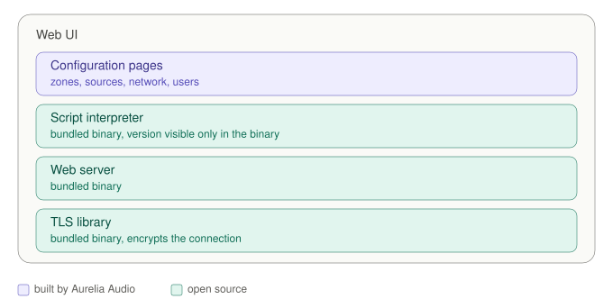

# Web UI

The web UI is what a technician sees when opening the controller's address in a browser. Besides the pages written by Aurelia Audio it needs a web server and a script interpreter, which are packed into the device as ready-made binaries.

## Building blocks

| Building block | What it does | Origin |
|---|---|---|
| Configuration pages | zones, sources, network, users | built by Aurelia Audio |
| Script interpreter | bundled binary, version visible only in the binary | open source |
| Web server | bundled binary | open source |
| TLS library | bundled binary, encrypts the connection | open source |

## Architecture in detail

- [Architecture description](https://github.com/trustsource/aura-venue-controller/blob/main/webui/ARCHITECTURE.md)
- [Diagram (draw.io)](https://github.com/trustsource/aura-venue-controller/blob/main/webui/ARCHITECTURE.drawio) (open in diagrams.net or the draw.io desktop app)
- [Repository](https://github.com/trustsource/aura-venue-controller)

The linked files are written in English.

## Status

Concept only; no product code yet.
