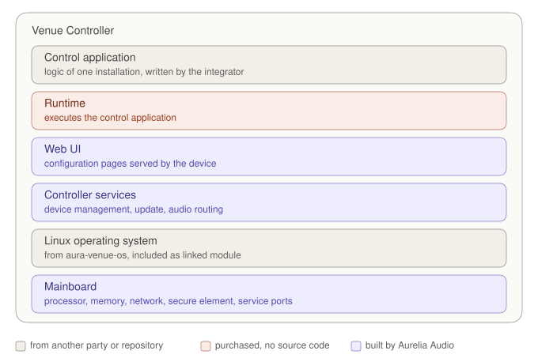

# Venue Controller

The Venue Controller is a small Linux computer in the equipment room. It receives the control application from Venue Studio, executes it in a purchased runtime and drives the amplifiers over the network. Its firmware is the whole package of the layers below, installed as one image.

## Building blocks

| Building block | What it does | Origin |
|---|---|---|
| Control application | logic of one installation, written by the integrator | from another party or repository |
| Runtime | executes the control application | purchased, no source code |
| Web UI | configuration pages served by the device | built by Aurelia Audio |
| Controller services | device management, update, audio routing | built by Aurelia Audio |
| Linux operating system | from aura-venue-os, included as linked module | from another party or repository |
| Mainboard | processor, memory, network, secure element, service ports | built by Aurelia Audio |

## Architecture in detail

- [Architecture description](https://github.com/trustsource/aura-venue-controller/blob/main/ARCHITECTURE.md)
- [Diagram (draw.io)](https://github.com/trustsource/aura-venue-controller/blob/main/ARCHITECTURE.drawio) (open in diagrams.net or the draw.io desktop app)
- [Hardware concept](https://github.com/trustsource/aura-venue-controller/blob/main/hardware/README.md)
- [Repository](https://github.com/trustsource/aura-venue-controller)

The linked files are written in English.

## Parts of the controller

- [Web UI](controller-webui.md)
- [Controller services](controller-services.md)
- [Runtime (LogicCore)](controller-runtime.md)
- [Venue OS](os.md)

## Status

Concept only; no product code yet.
