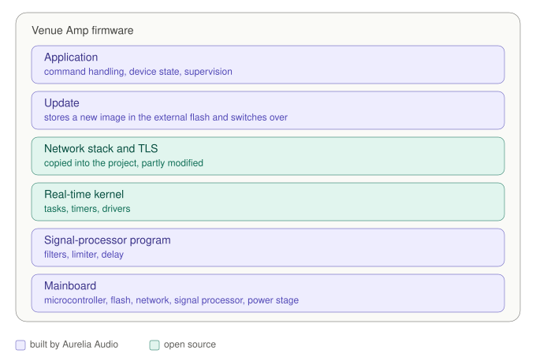

# Venue Amp firmware

The Venue Amp is a network amplifier with a microcontroller, a signal processor and a power stage. There is no operating system: the firmware is one program that runs directly on the chip. Third-party code is copied into the project, as is usual in embedded C.

## Building blocks

| Building block | What it does | Origin |
|---|---|---|
| Application | command handling, device state, supervision | built by Aurelia Audio |
| Update | stores a new image in the external flash and switches over | built by Aurelia Audio |
| Network stack and TLS | copied into the project, partly modified | open source |
| Real-time kernel | tasks, timers, drivers | open source |
| Signal-processor program | filters, limiter, delay | built by Aurelia Audio |
| Mainboard | microcontroller, flash, network, signal processor, power stage | built by Aurelia Audio |

## Architecture in detail

- [Architecture description](https://github.com/trustsource/aura-venue-firmware/blob/main/ARCHITECTURE.md)
- [Diagram (draw.io)](https://github.com/trustsource/aura-venue-firmware/blob/main/ARCHITECTURE.drawio) (open in diagrams.net or the draw.io desktop app)
- [Hardware concept](https://github.com/trustsource/aura-venue-firmware/blob/main/hardware/README.md)
- [Repository](https://github.com/trustsource/aura-venue-firmware)

The linked files are written in English.

## Status

Concept only; no product code yet.
