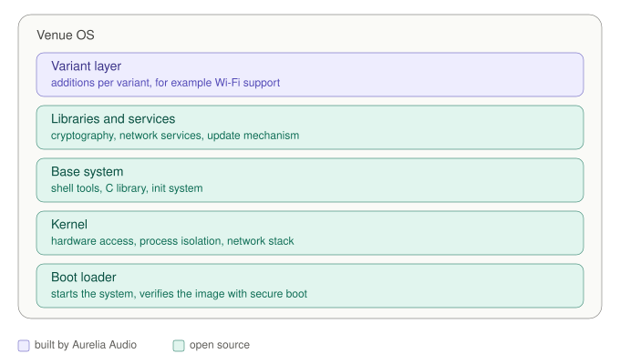

# Venue OS

Venue OS is the embedded Linux of the controller. A platform team assembles it from a distribution: a few hundred packages from the kernel to the cryptography library, none of them written by Aurelia Audio. It is maintained and approved separately and exists in several variants.

## Building blocks

| Building block | What it does | Origin |
|---|---|---|
| Variant layer | additions per variant, for example Wi-Fi support | built by Aurelia Audio |
| Libraries and services | cryptography, network services, update mechanism | open source |
| Base system | shell tools, C library, init system | open source |
| Kernel | hardware access, process isolation, network stack | open source |
| Boot loader | starts the system, verifies the image with secure boot | open source |

## Architecture in detail

- [Architecture description](https://github.com/trustsource/aura-venue-os/blob/main/ARCHITECTURE.md)
- [Diagram (draw.io)](https://github.com/trustsource/aura-venue-os/blob/main/ARCHITECTURE.drawio) (open in diagrams.net or the draw.io desktop app)
- [Repository](https://github.com/trustsource/aura-venue-os)

The linked files are written in English.

## Status

Concept only; no product code yet.
