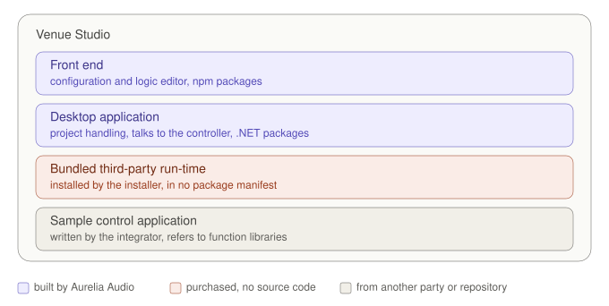

# Venue Studio

Venue Studio is the engineering software. It runs on a Windows PC at the planner's or integrator's office and is used to describe an installation, write its control logic and load both onto the controller.

## Building blocks

| Building block | What it does | Origin |
|---|---|---|
| Front end | configuration and logic editor, npm packages | built by Aurelia Audio |
| Desktop application | project handling, talks to the controller, .NET packages | built by Aurelia Audio |
| Bundled third-party run-time | installed by the installer, in no package manifest | purchased, no source code |
| Sample control application | written by the integrator, refers to function libraries | from another party or repository |

## Architecture in detail

- [Architecture description](https://github.com/trustsource/aura-venue-studio/blob/main/ARCHITECTURE.md)
- [Diagram (draw.io)](https://github.com/trustsource/aura-venue-studio/blob/main/ARCHITECTURE.drawio) (open in diagrams.net or the draw.io desktop app)
- [Repository](https://github.com/trustsource/aura-venue-studio)

The linked files are written in English.

## Status

Concept only; no product code yet.
