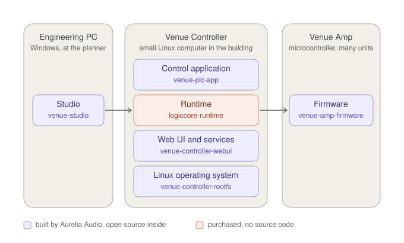

# The products

Aura Venue brings paging and background music into buildings such as hotels, schools or railway
stations. It consists of three products that work together.

## Venue Studio

The engineering software for planners and integrators. On a Windows PC they describe the building
(zones, amplifiers, sources) and write the control logic, for example "on fire alarm, page zone 3".
Studio then loads both onto the controller and helps with diagnosis during commissioning.

[Technical description](components/studio.md)

## Venue Controller

The centre of an installation: a small Linux computer in the equipment room. It executes the control
logic, serves a web interface for configuration and drives the amplifiers over the network. Variants
differ in equipment, for example with Wi-Fi or without a secure element.

Inside the controller several parts of different origin work together: the operating system, a
purchased runtime that executes the control logic, the web UI and the controller's own services.

[Technical description](components/controller.md)

## Venue Amp

The network amplifier. A building has many of them, one for each zone or group of loudspeakers. It
receives audio and commands from the controller, processes the sound and drives the loudspeakers.
Inside there is only a microcontroller; its firmware is a single program.

[Technical description](components/firmware.md)

## Who is involved

| Role | Who | Contribution |
|---|---|---|
| Manufacturer | Aurelia Audio | builds controller, amplifier and Studio; responsible for the products |
| Platform team | within Aurelia Audio | assembles and approves the operating system |
| Supplier | LogicCore (fictional) | delivers the runtime as a binary with its own documents |
| Manufacturing partner | electronics manufacturer | builds the boards, supplies bills of materials |
| Integrator | planning office or installer | writes the control logic of an installation |
| Operator | owner of the building | runs the installation, installs updates |

Each hand-over between these roles is a place where information about components and
vulnerabilities has to be passed on. That is what this example looks at.
