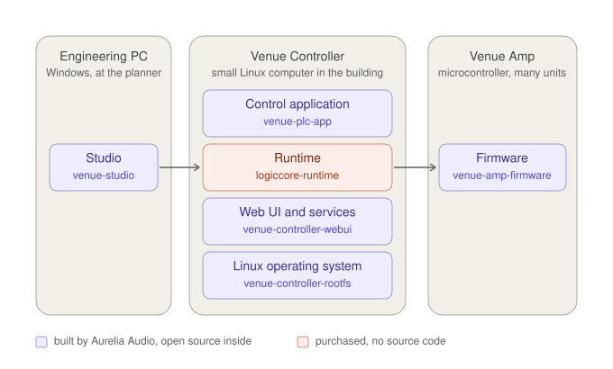

# Aura Venue

Aura Venue is a **fictional** fixed-installation audio system by the equally fictional Aurelia Audio
GmbH: a controller in the equipment room, network amplifiers throughout the building and an
engineering tool on the planner's PC. TrustSource builds it as a worked example.

This site documents the whole procedure and every design decision along the way. It is meant as a
teaching piece: what does the documentation of a product with digital elements look like when it is
kept from the first day, as the Cyber Resilience Act expects?

The engineering PC loads the control application onto the controller. The controller drives the
amplifiers over the network. Purple parts are built by Aurelia Audio (with open source inside), the
coral part is purchased as a binary without source code.

## The repositories

| Repository | Content | Runs on |
|---|---|---|
| [aura-venue-studio](https://github.com/trustsource/aura-venue-studio) | Engineering software, sample control application | Engineering PC (Windows) |
| [aura-venue-controller](https://github.com/trustsource/aura-venue-controller) | Web UI, controller services, purchased runtime, controller hardware concept | Venue Controller |
| [aura-venue-os](https://github.com/trustsource/aura-venue-os) | Embedded Linux of the controller, in several variants | Venue Controller |
| [aura-venue-firmware](https://github.com/trustsource/aura-venue-firmware) | Bare-metal firmware, amplifier hardware concept | Venue Amp |

## Status

The project has just started. The repositories contain structure and concepts, no product code yet.
The structure of this documentation is still being defined.

## Good to know

The files in the repositories do not have to build or run. They have to look like a real development
project, so that scanning, component identification, vulnerability matching, hardware bills of
materials and device threat analysis can be exercised on realistic input and measured against a
known ground truth.

Aurelia Audio and Aura Venue do not exist. Third-party products and parts named in this
documentation are real and are used as examples only.
